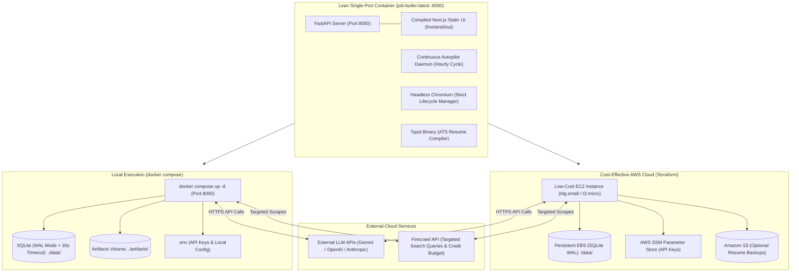

# Job Butler: System Architecture & Implementation Roadmap

## 1. System Overview & Philosophy

**Job Butler** is an autonomous, 24/7 career automation platform engineered for high cost-efficiency, complete self-containment, and zero wasted resources:
1. **Self-Contained Monorepo**: Everything required to understand, develop, test, build, deploy, and operate the platform is strictly contained within this single repository—including frontend (Next.js), backend (FastAPI/Python), profile knowledge bases, infrastructure (Terraform), CI/CD (GitHub Actions), and agent guidance (`AGENTS.md`).
2. **Local Environment**: Zero cloud costs. Runs via `docker compose` or directly with Python/Node for local execution, local testing, and 24/7 operation on your home/office machine.
3. **Cost-Optimized AWS Cloud Environment**: Deployed on low-cost **EC2 instances** (e.g., `t4g.small` / `t3.micro`), running Docker / Docker Compose. 
4. **External API-Based Intelligence & Ingestion**:
   - **Scraping**: Powered by the **Firecrawl API** (`FIRECRAWL_API_KEY`) to effortlessly bypass anti-bot defenses, handle JS-rendered portals, and scrape/crawl target job boards into clean markdown/structured data.
   - **LLM Operations**: All AI operations (resume tailoring, cover letter drafting, DOM reasoning) invoke external LLM APIs (Gemini, OpenAI, or Anthropic) via API keys passed through environment variables. No expensive self-hosted LLMs or GPU instances.
5. **Agent-Driven Codebase Design**: The repository includes [AGENTS.md](../AGENTS.md) at its root so that coding AI agents have complete, grounded context to autonomously inspect, test, modify, and evolve the codebase with zero ambiguity—backed by strict typing, deterministic test fixtures, and comprehensive TDD suites.

---

## 2. Cost-Effective Dual-Runtime Architecture (Local & AWS EC2)



### Monthly Cost Comparison
* **Fargate / Managed ECS + ALB + RDS**: ~$50 – $100+/month.
* **Our Cost-Optimized EC2 Architecture**: **~$3 – $8/month** (or **$0** within AWS Free Tier for `t3.micro`, or ~$4/mo on `t4g.micro`/`t4g.small`).

---

## 3. Storage & Environment Abstraction Layer

| Component | Local Mode (`APP_ENV=local`) | AWS EC2 Mode (`APP_ENV=production`) |
| :--- | :--- | :--- |
| **Compute** | Local Host / Docker Engine | Single-Node EC2 (`t4g.small` / `t3.micro`) |
| **LLM Provider** | External API via `.env` (`GEMINI_API_KEY`, etc.) | External API via SSM / EC2 env (`GEMINI_API_KEY`) |
| **Database** | SQLite WAL Mode (`PRAGMA journal_mode=WAL;`, 30s timeout) | SQLite WAL Mode on persistent EBS volume (`/data/job_butler.db`) |
| **Artifacts** | Local filesystem (`./artifacts/resumes/`) | Persistent EBS + optional S3 backup |
| **Browser Runner** | Headless Chromium (Strict Lifecycle Context) | Headless Chromium (Strict Lifecycle Context) |
| **Resume Compiler** | Embedded Typst CLI | Embedded Typst CLI |
| **Unified UI & API** | Port 8000 (FastAPI serves Next.js static export + API + WebSockets) | Port 8000 (`http://<EC2_IP>:8000` or behind Caddy/Nginx with SSL) |
| **Local Frontend Dev** | `npm run dev` on port 3000 (proxies to :8000) | N/A (Production serves pre-compiled static export) |

---

## 4. Targeted AI Agents & Ingestion Guardrails Specification

### 4.1 Resume & Cover Letter Tailor Agent
* **Role**: Analyzes the active job description and generates an ATS-optimized resume and tailored cover letter.
* **Two-Stage Drafter-Reviewer Pattern**:
  * **The Drafter**: Consumes verified `atomic_bullets` from `candidate_profile.yaml` across every `work_experience` entry (all roles are always rendered; only bullets are selected) and aligns them with 25–35 exact JD keywords.
  * **The Reviewer**: Validates that zero unverified claims exist, ensures dates are normalized (`Mon YYYY - Mon YYYY`), and enforces the geographic page budget.
* **Geographic Page Budget Rule**:
  * **Domestic (Tier 1, candidate's home market)**: Exactly 1 page.
  * **International Relocation (Tiers 2–4)**: Exactly 2 pages.
  * **Cover Letter**: Exactly 1 page (PDF + clean line-broken `.txt` for online form autofill).
* **Automated ATS Text-Layer Verification**:
  * Post-compilation step extracts the PDF text layer (`pypdf` / `pdftotext`) to confirm 100% extractable text, verbatim LinkedIn URL, and absence of CID replacement glitches.

### 4.2 Application Navigator Agent
* **Role**: Drives browser interactions across diverse and dynamic application portals.
* **Capabilities**:
  * Uses Playwright to load job application pages and extract form schemas.
  * Employs LLM DOM reasoning to match input fields with candidate profile data (e.g. mapping "Years of experience with backend frameworks" $\rightarrow$ `5`).
  * Uses pre-configured STAR stories from `candidate_profile.yaml` for behavioral application questions.
  * **Blocker Escalation**:
    * If the portal requires an account (e.g., Workday, Taleo), a CAPTCHA, or two-factor authentication, the agent pauses the workflow, screenshots the state, and posts an escalation event to the dashboard.
    * Once the user completes the account setup or solves the barrier on the dashboard, the agent resumes or marks the application completed.

### 4.3 Ingestion Guardrails & Sourcing Scope
* **Deep Live Link Verification**:
  * Ashby SPAs: verifies `window.__appData` payload for active posting.
  * Workday SPAs: checks `postingAvailable: true`.
  * All ATS: SmartRecruiters, Greenhouse, Lever, Workable, etc.
* **Employer Exclusions (Strict Auto-Purge)**:
  * Never scrapes or applies to any employer listed in `preferences.excluded_employers` (case-insensitive name match).
* **Market Sourcing Hierarchy Boost** (loaded from `preferences.sourcing_hierarchy`; active workspace values shown):
  * Tier 1: India Domestic (Bengaluru / Remote India +5, Delhi NCR / Hyderabad / Pune / Mumbai +3).
  * Tier 2: EU & Nordics, UAE / Dubai, US, Australia, New Zealand, Singapore, Japan (Visa Sponsorship, +4).
  * Tier 3: Rest of GCC / Middle East (Visa Sponsorship, +2).
  * Tier 4: UK, Canada, Worldwide Relocation & Global Remote.

---

## 5. Candidate Profile Data Structure & Mutability Architecture

### 5.1 Mutability, Hot-Reloading & Backup Versioning
The Candidate Profile is never static—it is designed to be updated at any point:
* **Multiple Editing Channels**:
  1. **Direct File Editing**: Edit `profile/candidate_profile.yaml` directly in any text editor.
  2. **CLI Mutation Tooling**: Run `job-butler profile edit`, `job-butler profile update-preferences`, or `job-butler profile add-bullet`.
  3. **Interactive Web UI Editor**: Edit contact info, target roles, salary floors, and atomic bullets directly via the Web Dashboard (`GET /api/profile` and `PUT /api/profile`).
* **Automated Backup Versioning**:
  * Every mutation automatically creates a timestamped snapshot in `profile/backups/candidate_profile_<YYYYMMDD_HHMMSS>.yaml` before writing changes.
  * Allows one-click rollback if accidental edits occur.
* **Autopilot Hot-Reloading & Frozen Snapshot**:
  * The 24/7 background worker reads the latest validated profile at the start of every sweep cycle.
  * **Concurrency Protection**: The scheduler creates a deep immutable copy (frozen snapshot) for the cycle. Any edits made via the Web UI while a sweep is executing are applied to disk safely, and the active sweep completes without `KeyError` or race conditions. The subsequent hourly sweep automatically picks up the updated snapshot.
* **Integrity & Fact-Hash Refresh**:
  * On profile save, the system recalculates deterministic hashes for modified bullets and validates all constraints (unique IDs, at least one `work_experience` entry, normalized dates) before persisting.

```yaml
# candidate_profile.yaml specification
personal_info:
  full_name: "Alex Doe"
  email: "alex.doe@example.com"
  phone: "+1-555-0199"
  location:
    city: "San Francisco"
    state: "CA"
    country: "USA"
    postal_code: "94105"
    timezone: "America/Los_Angeles"
  links:
    linkedin: "https://linkedin.com/in/alexdoe"
    github: "https://github.com/alexdoe"
    portfolio: "https://alexdoe.dev"
  work_authorization:
    authorized_countries: ["USA"]
    visa_sponsorship_required: false
    security_clearance: null

preferences:
  target_roles: ["Senior Backend Engineer", "Distributed Systems Engineer", "AI Platform Engineer"]
  target_locations: ["Remote", "San Francisco, CA", "New York, NY"]
  remote_policy: "remote_preferred" # remote_only | remote_preferred | hybrid | onsite
  min_base_salary: 160000
  currency: "USD"
  notice_period_days: 14
  excluded_employers: ["SpamCorp", "ShadyAgency"]
  excluded_keywords: ["Cryptocurrency", "Web3"]

skills_inventory:
  languages:
    - name: "Python"
      proficiency: "expert"
      years_of_experience: 6
      last_used_year: 2026
    - name: "Go"
      proficiency: "intermediate"
      years_of_experience: 2
      last_used_year: 2025
  frameworks_libraries:
    - name: "FastAPI"
      proficiency: "expert"
      years_of_experience: 4
    - name: "PyTorch"
      proficiency: "intermediate"
      years_of_experience: 2
  cloud_devops:
    - name: "Docker"
      proficiency: "advanced"
      years_of_experience: 5
    - name: "AWS (ECS, S3, RDS, Lambda)"
      proficiency: "advanced"
      years_of_experience: 4
  databases:
    - name: "PostgreSQL"
      proficiency: "advanced"
      years_of_experience: 5
    - name: "Redis"
      proficiency: "advanced"
      years_of_experience: 4

work_experience:
  - id: "exp_stripe_sr_eng"
    company: "Stripe"
    title: "Senior Backend Engineer"
    location: "San Francisco, CA (Remote)"
    start_date: "2023-01"
    end_date: null
    is_current: true
    summary: "Led high-throughput payments orchestration service scaling."
    atomic_bullets:
      - id: "b_stripe_1"
        text: "Architected event-driven payment reconciliation pipeline handling 15k TPS with 99.999% uptime."
        skills: ["Python", "FastAPI", "Kafka", "PostgreSQL", "Distributed Systems"]
        metrics:
          throughput_tps: 15000
          availability: "99.999%"
        tags: ["high_scale", "fintech", "backend", "concurrency"]
      - id: "b_stripe_2"
        text: "Reduced P99 query latency from 240ms to 42ms by migrating hot transaction caches to Redis Cluster."
        skills: ["Redis", "PostgreSQL", "Query Optimization"]
        metrics:
          latency_drop_ms: 198
        tags: ["performance", "caching", "database"]

projects:
  - id: "proj_vector_search"
    name: "VectorStream"
    repo_url: "https://github.com/alexdoe/vectorstream"
    live_url: "https://vectorstream.dev"
    summary: "Open-source real-time semantic search indexing engine."
    atomic_bullets:
      - id: "b_proj_1"
        text: "Built asynchronous hybrid vector retrieval engine indexing 2M embeddings per minute."
        skills: ["Go", "ChromaDB", "Docker", "gRPC"]
        metrics:
          indexing_rate: "2M/min"
        tags: ["vector_search", "open_source"]

education:
  - institution: "University of California, Berkeley"
    degree: "B.S."
    field_of_study: "Computer Science"
    start_date: "2016"
    end_date: "2020"
    gpa: "3.85"

screening_question_bank:
  - question_pattern: "(?i)years of experience with python"
    answer_type: "number"
    answer_value: 6
  - question_pattern: "(?i)authorized to work"
    answer_type: "boolean"
    answer_value: true
  - question_pattern: "(?i)require sponsorship"
    answer_type: "boolean"
    answer_value: false
  - question_pattern: "(?i)notice period"
    answer_type: "text"
    answer_value: "2 weeks"
  - question_pattern: "(?i)expected salary|compensation"
    answer_type: "number"
    answer_value: 175000
```

---

## 6. Real-Time UI Dashboard & Human-in-the-Loop Hub

* **Modern Decoupled Frontend**: Built with **Next.js (App Router)**, **React.js**, and styled with **Tailwind CSS**. Communicates with the FastAPI backend via type-safe REST calls and a resilient WebSocket connection for real-time telemetry.
* **Centralized Action Audit Explorer (`/audit`)**:
  * Complete historical ledger of every single action performed by the agent (scouting, verifying, tailoring, applying) or the human (resolving blockers, updating preferences).
  * Filterable by Actor (`agent` vs `human`), Action Type, and Status (`SUCCESS`, `WARNING`, `FAILURE`).
  * Deep inspection drawer showing exact input parameters, diffs, execution duration, and full stack traces for failures.
* **Real-Time Stream**: Live streaming timeline showing scouted positions, deep liveness validation checks, ATS tailoring progress, and application results.
* **HITL Escalation Center**:
  * Displays jobs requiring user action (portal login, CAPTCHA, MFA).
  * Direct access to one-click tailored resume download, copy-ready answers to screening questions, and a "Mark as Applied" button.
* **Interactive Profile & Preferences Editor**:
  * In-browser visual form and YAML editor allowing seamless editing of candidate contact details, target roles, salary floors, atomic bullets, and screening questions at any time.
  * Real-time schema validation with instant error feedback and automatic backup creation on save.
* **Upskilling & Trend Analytics**:
  * Interactive charts (Tremor / Recharts) displaying in-demand tech stacks across all ingested postings.
  * ROI-ranked recommendations highlighting skills that would unlock the highest number of eligible roles.

---

## 7. Centralized Audit Logging, CloudWatch Monitoring & Error Tracking

### 7.1 Centralized Action Audit Trail (`audit_logs`)
Every state change, automated action, and human interaction is recorded in a dedicated relational table:

| Column | Type | Description |
| :--- | :--- | :--- |
| `id` | `VARCHAR(36)` | Unique UUID primary key |
| `timestamp` | `DATETIME` | ISO 8601 UTC timestamp |
| `actor` | `VARCHAR(50)` | `agent:scout`, `agent:tailor`, `agent:navigator`, `agent:autopilot`, `human:user` |
| `action` | `VARCHAR(50)` | `JOB_DISCOVERED`, `LINK_VERIFIED`, `RESUME_TAILORED`, `FORM_SUBMITTED`, `HITL_ESCALATED`, `PROFILE_UPDATED` |
| `target_id` | `VARCHAR(100)` | Associated `job_id` or `bullet_id` (nullable) |
| `status` | `VARCHAR(20)` | `SUCCESS`, `WARNING`, `FAILURE` |
| `duration_ms` | `INTEGER` | Execution duration in milliseconds |
| `metadata` | `JSON` | Structured context payload (inputs, diffs, error details, response codes) |

### 7.2 CloudWatch Structured Logging & Metric Alarms
* **Standardized JSON Log Format**: Python backend emits structured JSON log entries:
  ```json
  {"timestamp": "2026-10-22T01:15:00Z", "level": "ERROR", "service": "navigator", "action": "FORM_SUBMISSION_FAILED", "job_id": "job_01", "error": "Timeout 30000ms exceeded", "stack_trace": "..."}
  ```
* **Local Mode**: Logs streamed cleanly to terminal and written to `./data/logs/job_butler.log`.
* **AWS Cloud Mode**: 
  * Docker `awslogs` log driver or CloudWatch Unified Agent streams logs directly to AWS CloudWatch Log Group `/job-butler/production` with 30-day retention.
  * **CloudWatch Metric Filter & Alarm**: Monitors `level == "ERROR"`; triggers an alarm if error count exceeds 5 in 15 minutes.

---

## 8. Cost-Effective Terraform & GitHub Actions CI/CD

### 8.1 Terraform Architecture (AWS EC2)
* **`ec2` module**:
  * Provisions a low-cost `t4g.small` (ARM64) or `t3.micro` EC2 instance.
  * Attaches an elastic IP and security group (ports 22, 80, 443, 8000).
  * Provisions an attached persistent EBS volume for SQLite database storage and resume artifacts.
  * `user_data` script installs Docker & Docker Compose and pulls the application container.
* **`cloudwatch` module**:
  * Provisions CloudWatch Log Group `/job-butler/production` with 30-day retention.
  * Provisions CloudWatch Metric Filter and Alarm for application errors.
* **`ssm` module**:
  * Securely stores LLM API keys (`GEMINI_API_KEY`, `OPENAI_API_KEY`, etc.) and Firecrawl keys in AWS Systems Manager Parameter Store.
* **`s3` module (Optional)**:
  * Low-cost S3 bucket for cold-storage backups of generated resumes.

### 8.2 GitHub Actions Workflows
* **`ci.yml`**:
  * Triggered on every commit/PR: executes `ruff` linting, `mypy` strict type checks, and `pytest` TDD suite.
* **`deploy.yml`**:
  * Triggered on merge to `main`: builds the Docker image, tags and pushes to Amazon ECR (or GitHub Container Registry `ghcr.io`), and triggers a seamless container update on the EC2 instance via SSH/AWS SSM Run Command.

---

## 9. Incremental TDD Slice Delivery Roadmap (Usable Product at Every Step)

Every slice is implemented through the **Red $\rightarrow$ Green $\rightarrow$ Refactor** cycle, culminating in a concrete, runnable feature you can execute immediately:

* **[Slice 1: Candidate Profile & Config Core](slices/slice-01-profile-and-config.md)**
  * **Runnable Output**: `job-butler profile validate`, `job-butler profile query "screening question"`, and `job-butler profile export-master`.
  * Validates your profile schema, guarantees unique fact-hashed atomic bullets, and tests automated screening answers.
* **[Slice 2: Job Scout & Live Link Verifier CLI](slices/slice-02-ingestion-and-verification.md)**
  * **Runnable Output**: `job-butler scout run` and `job-butler scout list`.
  * Scrapes target jobs via Firecrawl and ATS feeds, checks active link liveness, deduplicates into SQLite, and displays active roles in a formatted terminal table.
* **[Slice 3: AI Resume Tailor & ATS Scorer CLI](slices/slice-03-tailor-agent.md)**
  * **Runnable Output**: `job-butler tailor --job-id <ID>`.
  * Evaluates ATS fit score, extracts JD keywords, selects verified atomic bullets (zero hallucinations), and compiles a ready-to-submit ATS PDF via Typst.
* **[Slice 4: Real-Time Web Dashboard](slices/slice-04-realtime-web-dashboard.md)**
  * **Runnable Output**: `job-butler serve` at `http://localhost:8000`.
  * Modern web UI streaming real-time WebSocket events, listing active jobs, displaying ATS match badges, and providing 1-click tailored PDF resume downloads.
* **[Slice 5: Auto-Apply Navigator & HITL Escalation](slices/slice-05-auto-apply-and-hitl.md)**
  * **Runnable Output**: `job-butler apply --job-id <ID>` & Web Dashboard HITL Queue.
  * Headless Playwright submits direct ATS forms with confirmation screenshots; automatically escalates account portals, CAPTCHAs, and 2FA to the Web Dashboard with 1-click resolution.
* **[Slice 6: 24/7 Autopilot Scheduler & Upskilling Insights](slices/slice-06-autopilot-and-upskilling.md)**
  * **Runnable Output**: `job-butler autopilot start` & `job-butler analytics report`.
  * 24/7 background worker running hourly cycles; real-time dashboard analytics displaying market demand heatmaps and mathematical upskilling recommendations.
* **[Slice 7: Dockerization, Low-Cost EC2 Terraform & CI/CD](slices/slice-07-docker-ec2-terraform-cicd.md)**
  * **Runnable Output**: `make up` (local Docker Compose) & `terraform apply` (AWS EC2 deployment).
  * Multi-stage `Dockerfile`, 1-click local Docker Compose, Terraform modules for low-cost EC2/EBS/SSM, and GitHub Actions automated CI/CD workflows.

