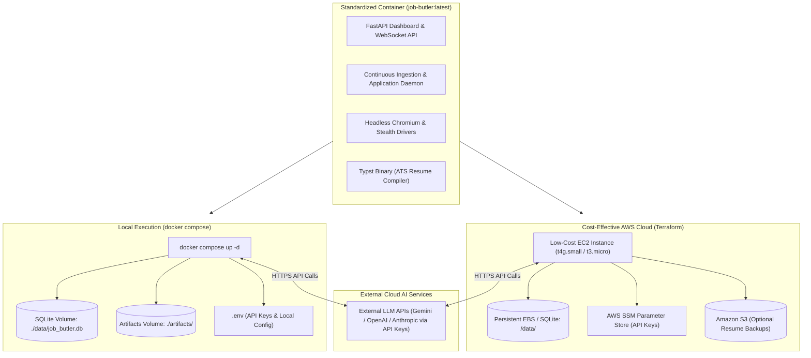

# Job Butler: System Architecture & Implementation Roadmap

## 1. System Overview & Philosophy

**Job Butler** is an autonomous, 24/7 career automation platform engineered for high cost-efficiency and zero wasted resources:
1. **Local Environment**: Zero cloud costs. Runs via `docker compose` or directly with Python for local execution, local testing, and 24/7 operation on your home/office machine.
2. **Cost-Optimized AWS Cloud Environment**: Deployed on low-cost **EC2 instances** (e.g., `t4g.micro` / `t4g.small` Graviton or `t3.micro`), running Docker / Docker Compose. 
3. **External API-Based Intelligence**: No expensive self-hosted LLMs or GPU instances. All AI operations (resume tailoring, cover letter drafting, DOM reasoning) invoke external LLM APIs (Gemini, OpenAI, or Anthropic) via API keys passed through environment variables.
4. **Agent-Driven Codebase Design**: The repository is structured specifically so that coding AI agents can autonomously inspect, test, modify, and evolve the codebase with zero ambiguity—backed by strict typing, deterministic test fixtures, and comprehensive TDD suites.

---

## 2. Cost-Effective Dual-Runtime Architecture (Local & AWS EC2)



### Monthly Cost Comparison
* **Fargate / Managed ECS + ALB + RDS**: ~$50 – $100+/month.
* **Our Cost-Optimized EC2 Architecture**: **~$3 – $8/month** (or **$0** within AWS Free Tier for `t3.micro`, or ~$4/mo on `t4g.micro`/`t4g.small`).

---

## 3. Storage & Environment Abstraction Layer

| Component | Local Mode (`APP_ENV=local`) | AWS EC2 Mode (`APP_ENV=production`) |
| :--- | :--- | :--- |
| **Compute** | Local Host / Docker Engine | Single or Multi-Node EC2 (`t4g.small` / `t3.micro`) |
| **LLM Provider** | External API via `.env` (`GEMINI_API_KEY`, etc.) | External API via SSM / EC2 env (`GEMINI_API_KEY`) |
| **Database** | SQLite (`sqlite:///data/job_butler.db`) | SQLite on persistent EBS volume (`/data/job_butler.db`) |
| **Artifacts** | Local filesystem (`./artifacts/resumes/`) | Persistent EBS + optional S3 backup |
| **Browser Runner** | Headless Playwright Chromium | Headless Playwright Chromium |
| **Resume Compiler** | Embedded Typst CLI | Embedded Typst CLI |
| **UI Dashboard** | `http://localhost:8000` | `http://<EC2_PUBLIC_IP>:8000` (or reverse proxy / Caddy with free Let's Encrypt SSL) |

---

## 4. Targeted AI Agents Specification

### 4.1 Resume & Cover Letter Tailor Agent
* **Role**: Analyzes the active job description and generates an ATS-optimized resume and tailored cover letter.
* **Zero-Hallucination Policy**:
  * Consumes verified `atomic_bullets` from `candidate_profile.yaml`.
  * The agent is strictly constrained to **rank, select, and emphasize existing verified facts and metrics**.
  * Recompiles the selected bullets into an ATS-compliant, single-column **Typst PDF** and Markdown/plain text cover letter.

### 4.2 Application Navigator Agent
* **Role**: Drives browser interactions across diverse and dynamic application portals.
* **Capabilities**:
  * Uses Playwright to load job application pages and extract form schemas.
  * Employs LLM DOM reasoning to match input fields with candidate profile data (e.g. mapping "Years of experience with backend frameworks" $\rightarrow$ `6`).
  * **Blocker Escalation**:
    * If the portal requires an account (e.g., Workday, Taleo), a CAPTCHA, or two-factor authentication, the agent pauses the workflow, screenshots the state, and posts an escalation event to the dashboard.
    * Once the user completes the account setup or solves the barrier on the dashboard, the agent resumes or marks the application completed.

---

## 5. Candidate Profile Data Structure

```yaml
# candidate_profile.yaml specification
personal_info:
  full_name: "Alex Doe"
  email: "alex.doe@example.com"
  phone: "+1-555-0199"
  location:
    city: "San Francisco"
    state: "CA"
    country: "USA"
    postal_code: "94105"
    timezone: "America/Los_Angeles"
  links:
    linkedin: "https://linkedin.com/in/alexdoe"
    github: "https://github.com/alexdoe"
    portfolio: "https://alexdoe.dev"
  work_authorization:
    authorized_countries: ["USA"]
    visa_sponsorship_required: false
    security_clearance: null

preferences:
  target_roles: ["Senior Backend Engineer", "Distributed Systems Engineer", "AI Platform Engineer"]
  target_locations: ["Remote", "San Francisco, CA", "New York, NY"]
  remote_policy: "remote_preferred" # remote_only | remote_preferred | hybrid | onsite
  min_base_salary: 160000
  currency: "USD"
  notice_period_days: 14
  excluded_companies: ["SpamCorp", "ShadyAgency"]
  excluded_keywords: ["Cryptocurrency", "Web3"]

skills_inventory:
  languages:
    - name: "Python"
      proficiency: "expert"
      years_of_experience: 6
      last_used_year: 2026
    - name: "Go"
      proficiency: "intermediate"
      years_of_experience: 2
      last_used_year: 2025
  frameworks_libraries:
    - name: "FastAPI"
      proficiency: "expert"
      years_of_experience: 4
    - name: "PyTorch"
      proficiency: "intermediate"
      years_of_experience: 2
  cloud_devops:
    - name: "Docker"
      proficiency: "advanced"
      years_of_experience: 5
    - name: "AWS (ECS, S3, RDS, Lambda)"
      proficiency: "advanced"
      years_of_experience: 4
  databases:
    - name: "PostgreSQL"
      proficiency: "advanced"
      years_of_experience: 5
    - name: "Redis"
      proficiency: "advanced"
      years_of_experience: 4

work_experience:
  - id: "exp_stripe_sr_eng"
    company: "Stripe"
    title: "Senior Backend Engineer"
    location: "San Francisco, CA (Remote)"
    start_date: "2023-01"
    end_date: null
    is_current: true
    summary: "Led high-throughput payments orchestration service scaling."
    atomic_bullets:
      - id: "b_stripe_1"
        text: "Architected event-driven payment reconciliation pipeline handling 15k TPS with 99.999% uptime."
        skills: ["Python", "FastAPI", "Kafka", "PostgreSQL", "Distributed Systems"]
        metrics:
          throughput_tps: 15000
          availability: "99.999%"
        tags: ["high_scale", "fintech", "backend", "concurrency"]
      - id: "b_stripe_2"
        text: "Reduced P99 query latency from 240ms to 42ms by migrating hot transaction caches to Redis Cluster."
        skills: ["Redis", "PostgreSQL", "Query Optimization"]
        metrics:
          latency_drop_ms: 198
        tags: ["performance", "caching", "database"]

projects:
  - id: "proj_vector_search"
    name: "VectorStream"
    repo_url: "https://github.com/alexdoe/vectorstream"
    live_url: "https://vectorstream.dev"
    summary: "Open-source real-time semantic search indexing engine."
    atomic_bullets:
      - id: "b_proj_1"
        text: "Built asynchronous hybrid vector retrieval engine indexing 2M embeddings per minute."
        skills: ["Go", "ChromaDB", "Docker", "gRPC"]
        metrics:
          indexing_rate: "2M/min"
        tags: ["vector_search", "open_source"]

education:
  - institution: "University of California, Berkeley"
    degree: "B.S."
    field_of_study: "Computer Science"
    start_date: "2016"
    end_date: "2020"
    gpa: "3.85"

screening_question_bank:
  - question_pattern: "(?i)years of experience with python"
    answer_type: "number"
    answer_value: 6
  - question_pattern: "(?i)authorized to work"
    answer_type: "boolean"
    answer_value: true
  - question_pattern: "(?i)require sponsorship"
    answer_type: "boolean"
    answer_value: false
  - question_pattern: "(?i)notice period"
    answer_type: "text"
    answer_value: "2 weeks"
  - question_pattern: "(?i)expected salary|compensation"
    answer_type: "number"
    answer_value: 175000
```

---

## 6. Real-Time UI Dashboard & Human-in-the-Loop Hub

* **Real-Time Stream**: Live updates showing scraped positions, live validation status, tailoring events, and application results.
* **HITL Escalation Center**:
  * Displays jobs requiring user action (portal login, CAPTCHA, MFA).
  * Direct access to one-click tailored resume download, copy-ready answers to screening questions, and a "Mark as Applied" button.
* **Upskilling & Trend Analytics**:
  * Aggregated hiring demand metrics across all ingested postings.
  * ROI-ranked recommendations highlighting skills that would unlock the highest number of eligible roles.

---

## 7. Cost-Effective Terraform & GitHub Actions CI/CD

### 7.1 Terraform Architecture (AWS EC2)
* **`ec2` module**:
  * Provisions a low-cost `t4g.small` (ARM64) or `t3.micro` EC2 instance.
  * Attaches an elastic IP and security group (ports 22, 80, 443, 8000).
  * Provisions an attached persistent EBS volume for SQLite database storage and resume artifacts.
  * `user_data` script installs Docker & Docker Compose and pulls the application container.
* **`ssm` module**:
  * Securely stores LLM API keys (`GEMINI_API_KEY`, `OPENAI_API_KEY`, etc.) in AWS Systems Manager Parameter Store.
* **`s3` module (Optional)**:
  * Low-cost S3 bucket for cold-storage backups of generated resumes.

### 7.2 GitHub Actions Workflows
* **`ci.yml`**:
  * Triggered on every commit/PR: executes `ruff` linting, `mypy` strict type checks, and `pytest` TDD suite.
* **`deploy.yml`**:
  * Triggered on merge to `master`: builds the Docker image, tags and pushes to Amazon ECR (or GitHub Container Registry `ghcr.io`), and triggers a seamless container update on the EC2 instance via SSH/AWS SSM Run Command.

---

## 8. Incremental TDD Slice Delivery Roadmap

Each slice is implemented with the **Red $\rightarrow$ Green $\rightarrow$ Refactor** cycle:

* **Slice 1: Candidate Profile & Config Core**
  * Pydantic schemas for `CandidateProfile`, validation rules, YAML loaders, atomic bullet verification tests.
* **Slice 2: Deterministic Ingestion & Link Verification Engine**
  * Base scraper interfaces, Greenhouse & Lever scrapers, HTTP link live-checker, deduplication cache.
* **Slice 3: Resume & Cover Letter Tailor Agent (API-driven LLM)**
  * ATS keyword extractor, atomic bullet selection engine (zero hallucination constraint), Typst PDF compiler and tests.
* **Slice 4: Application Navigator Agent & HITL Escalation**
  * Playwright form automation for direct ATS targets, blocker detection (CAPTCHA/login detection), fallback queue manager.
* **Slice 5: Real-Time UI Dashboard & Human Escalation Interface**
  * FastAPI REST + WebSocket backend, real-time activity stream, interactive HITL resolution interface, analytics & upskill graphs.
* **Slice 6: Analytics, Market Trends & Upskilling Engine**
  * Skill demand frequency aggregator, trend visualizer, upskilling ROI recommendation logic.
* **Slice 7: Dockerization, Low-Cost EC2 Terraform & CI/CD**
  * Multi-stage `Dockerfile`, `docker-compose.yml` for local runs, cost-effective EC2 Terraform modules (t4g.small/t3.micro, EBS, SSM), and GitHub Actions CI/CD workflows.
