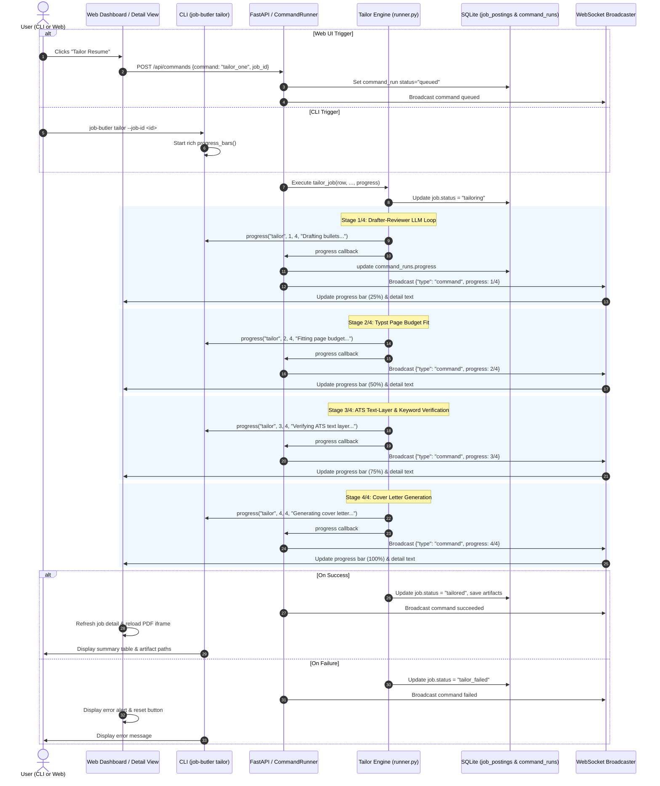

# Architecture & Implementation Plan: Resume Tailoring Progress & Persistent Job Status

## 1. Executive Summary

This plan addresses the user requirement to:
1. **Show resume tailoring progress** in real time on both the **Web UI** and the **CLI**.
2. **Display job status** clearly on the Web UI (both on job cards and in the job detail split view).
3. **Persist job status** in the SQLite database (`job_postings` table) with robust state transitions (`discovered` → `tailoring` → `tailored` / `tailor_failed` / `applied`).

All changes adhere to strict TDD, zero candidate hardcoding (AGENTS.md §2), and small reviewable changes (< 300 lines of code total).

---

## 2. System Architecture & Telemetry Flow

The following diagram illustrates how tailoring commands initiated either from the CLI or Web Dashboard trigger status updates in SQLite, stream progress updates across 4 tailoring phases, and render live feedback in both environments:



---

## 3. Database & Model Schema Migration

### 3.1 Job Status Enum & Column
In `src/storage/models.py`:
- Define `JobStatus(StrEnum)`:
  - `DISCOVERED = "discovered"` (Initial state upon scraping / ingestion)
  - `TAILORING = "tailoring"` (Tailoring pipeline in progress)
  - `TAILORED = "tailored"` (Resume & cover letter generated and verified)
  - `TAILOR_FAILED = "tailor_failed"` (Tailoring failure, e.g. text-layer or LLM failure)
  - `APPLIED = "applied"` (Application submitted or recorded manually)
- Add column on `JobPosting`:
  ```python
  status: Mapped[str] = mapped_column(String(30), default=JobStatus.DISCOVERED, index=True)
  ```

### 3.2 Safe SQLite Migration
In `src/storage/database.py` (`init_db`):
- Use `sqlalchemy.inspect` to verify if column `status` exists in `job_postings`.
- If missing, execute idempotent raw DDL:
  ```sql
  ALTER TABLE job_postings ADD COLUMN status VARCHAR(30) DEFAULT 'discovered'
  ```
- This ensures existing local development databases (`data/jobs.db`) upgrade seamlessly without data loss or requiring Alembic.

### 3.3 Repository Helpers
In `src/storage/repository.py`:
- Add `update_job_status(session: Session, job_id: str, status: str) -> JobPosting | None`
- In `upsert_job`, initialize `status=JobStatus.DISCOVERED` for new rows, while preserving existing status when re-sighting active jobs.

---

## 4. Progress Reporting Callback Wiring

### 4.1 Granular Stages in `tailor_job`
In `src/agents/tailor/runner.py`:
- Update `tailor_job` signature:
  ```python
  def tailor_job(
      row: JobPosting,
      profile: CandidateProfile,
      llm: LLMClient,
      artifacts_dir: Path,
      session: Session,
      progress: ProgressFn = no_progress,
  ) -> TailorResult:
  ```
- Emit structured 4-step progress:
  - `progress("tailor", 0, 4, "Starting resume tailoring...")` & `row.status = JobStatus.TAILORING; session.commit()`
  - Step 1: `progress("tailor", 1, 4, "Drafting & ranking bullets with LLM...")`
  - Step 2: `progress("tailor", 2, 4, "Fitting Typst page budget...")`
  - Step 3: `progress("tailor", 3, 4, "Verifying ATS text-layer & keywords...")`
  - Step 4: `progress("tailor", 4, 4, "Writing tailored cover letter...")`
  - On complete: `row.status = JobStatus.TAILORED; session.commit()`
  - On error: `row.status = JobStatus.TAILOR_FAILED; session.commit()`

### 4.2 Service Layer Hook
In `src/services/tailor.py`:
- Update `tailor_one(..., progress: ProgressFn = no_progress)` and pass `progress=progress` into `tailor_job`.

### 4.3 Command Runner & WebSocket Telemetry
In `src/server/runner.py`:
- In `_run_sync` under `command == "tailor_one"`, pass `progress=progress` into `tailor_service.tailor_one`.
- `runner.py`'s existing telemetry loop throttles updates and broadcasts `{"type": "command", "run": serialize_run(updated)}` over WebSockets to connected frontends.

---

## 5. CLI Experience

In `src/cli_tailor.py`:
- For single-job tailoring (`--job-id <id>`):
  - Wrap the call in `with progress_bars() as progress:`
  - Pass `progress=progress` to `tailor_service.tailor_one(...)`
- In `src/cli_common.py`:
  - Register `"tailor": "Tailoring resume"` in `STAGES` so Rich's progress bar displays:
    ```text
    ⠋ Tailoring resume  ━━━━━━━━━━━━━━━━━━━━ 2/4 00:03 Fitting Typst page budget...
    ```

---

## 6. Frontend Dashboard & Detail Route Enhancements

### 6.1 Type & API Synchronization
In `frontend/lib/api.ts`:
- Add `status: string;` to `Job` and `JobDetail` types.

### 6.2 Job Card (`frontend/components/JobCard.tsx`)
- Render a status badge in the metadata row:
  - `discovered`: neutral gray badge ("Discovered")
  - `tailoring`: purple/indigo badge with spinning icon ("Tailoring…")
  - `tailored`: emerald badge with checkmark ("Tailored")
  - `tailor_failed`: red badge ("Tailor Failed")
  - `applied`: sky blue badge ("Applied")

### 6.3 Job Detail View (`frontend/app/jobs/detail/page.tsx`)
- Display the status badge in the top header next to Fit score.
- When `tailoring` is active (triggered or received via WebSocket event `msg.run.status === "running"`):
  - Display an animated progress bar card:
    - Step counter: e.g. `Step 2 of 4 (50%)`
    - Progress fill: smooth animated CSS transition `width: (done / total) * 100%`
    - Detail message: `msg.run.progress?.detail` (e.g. "Fitting Typst page budget…")
- When tailoring succeeds:
  - Transition status pill to "Tailored"
  - Reload job data and reload the PDF iframe seamlessly.

---

## 7. Test-Driven Development & Verification Plan

### 7.1 Backend Unit & Integration Tests
1. **Schema & Migration Test** (`tests/unit/test_storage_migration.py`):
   - Verify table creation with default `status = "discovered"`.
   - Verify `init_db` idempotently runs `ALTER TABLE` if column is absent in an existing database.
2. **Tailor Runner Progress & Status Test** (`tests/unit/test_slice3_tailor_runner_progress.py`):
   - Mock LLM, verify `progress(...)` is called 4 times with `total=4` and expected messages.
   - Verify `row.status` is updated to `"tailoring"` at start, and `"tailored"` upon completion.
   - Verify error during drafting/fitting sets `row.status = "tailor_failed"`.
3. **CLI Progress Test** (`tests/unit/test_slice3_cli_tailor.py`):
   - Verify `job-butler tailor --job-id <id>` executes with `progress_bars()` and returns zero exit code.

### 7.2 Frontend Vitest Tests
1. **JobCard Status Test** (`frontend/__tests__/JobCard.test.tsx`):
   - Verify status badge renders correctly for `discovered`, `tailoring`, `tailored`, etc.
2. **JobDetailPage Progress Test** (`frontend/__tests__/JobDetailPage.test.tsx`):
   - Mock WebSocket event with progress `{ done: 2, total: 4, detail: "Fitting Typst page budget..." }`
   - Assert progress bar (50%) and detail text render on screen.

### 7.3 End-to-End Verification
- Run `make test` (pytest + npm test)
- Run `make lint` (`ruff check` and `mypy --strict`)
- Run CLI command `job-butler tailor --job-id <id>` and inspect terminal output.
